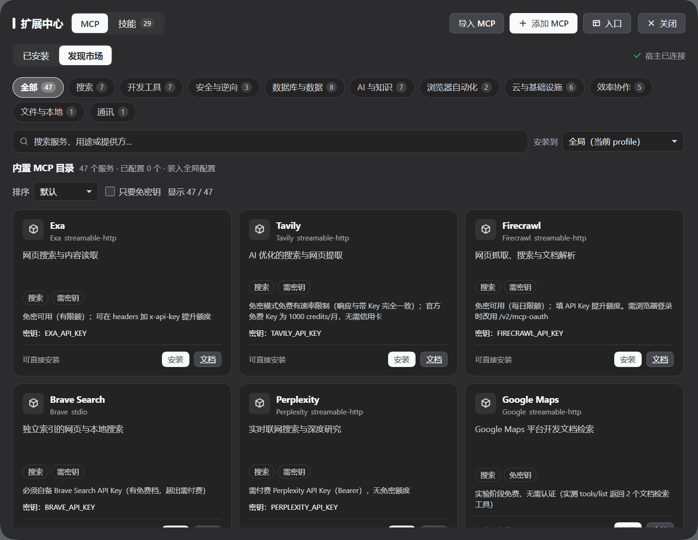
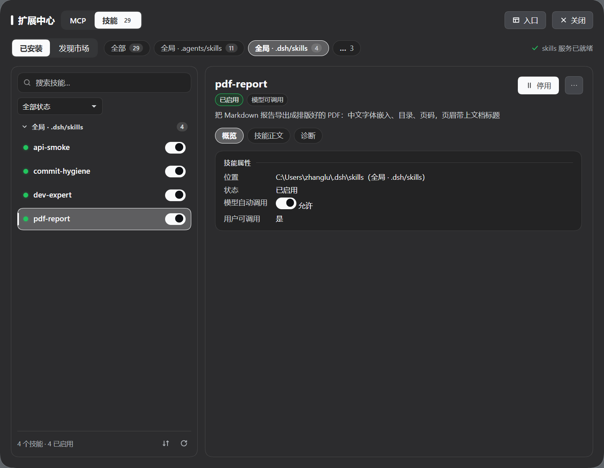

<p align="center">
  
</p>

<h1 align="center">dsh-toolbox-ui</h1>

<p align="center">DeepSeek Harness Web 的 <b>MCP 管理面板</b> + <b>技能管理面板</b></p>

<p align="center">
  <a href="https://www.npmjs.com/package/dsh-toolbox-ui"></a>
  <a href="https://www.npmjs.com/package/dsh-toolbox-ui"></a>
  <a href="https://github.com/Imzl-zl/dsh-toolbox-ui/actions/workflows/ci.yml"></a>
  <a href="./LICENSE"></a>
  = 0.1.5-rc.1">
</p>

点右下角悬浮按钮或侧栏「工具箱」打开，面板浮在会话之上——改配置、看技能，都不打断正在进行的对话。两个能力面在同一个面板里切换：**MCP** 与**技能**。

## 界面预览

### MCP 市场



47 个逐条一手核实过的服务，分 10 类；搜索为主操作，配「只要免密钥」筛选与排序。每条如实标注免费额度、要准备什么（密钥 / 连接信息 / 装完还得改的参数），卡片直接安装；已配置的只识别并跳过。

### 技能面板



看本机每个技能的**真实作用域**与同名遮蔽，启停、删除、读正文与诊断，并一键切换「模型自动调用」——它直接改 `SKILL.md` 的 `disable-model-invocation`，只动那一行。

## 特性

**MCP 面**

- 逐条看状态、传输方式、连接参数与**已注册的工具**；展开工具可看完整输入 JSON Schema（必填/可选、类型、枚举、默认值）
- 启停、重连、添加、编辑、移除；凭据类字段默认掩码，点眼睛临时揭示有效运行值并一键复制
- **全局 + 项目双作用域**：全局写 Web profile（所有项目可用），项目写该项目 `.dsh/mcp.json`（只该项目会话可见）；项目里还能「屏蔽」某个全局 MCP
- 从本机其他客户端**导入**：Claude Code、Codex、OpenCode、pi、Claude Desktop、Cursor、Windsurf、VS Code、Gemini CLI、Roo Code 与跨工具共享配置，也能直接粘贴 JSON；写入前预览，支持「合并」与「替换」
- **跨工作区搬运**：把本项目的 MCP 复制到另一个已注册工作区（在宿主内完成，凭据不经过浏览器），或导出成 JSON 备份 / 分享

**技能面**

- 真实作用域与同名遮蔽：同名技能跨作用域是合法配置，面板逐条列出并标出哪一份生效
- 启停（`.disabled`）、删除、读正文与诊断——「技能不生效」的原因直接摆在面板里
- **「模型自动调用」开关**：直接改 `SKILL.md` 的 `disable-model-invocation`，关掉=删掉那一行（开→关能逐字节还原原文）；状态一律取自技能文件本身，读不出来就说「未知」而不是猜一个值
- 市场接 [skillhub.cn](https://skillhub.cn)：安装前披露发布方认证与安全扫描结论，并要一次**显式确认**（该确认在服务端校验）

**公共**

- 入口三选一：右下角悬浮按钮（可拖拽、记忆位置）+ 侧栏「工具箱」；可以只留一个，不能都关
- 跟随 DSH 深色/浅色主题，适配窄屏与移动宽度
- 更新提示与一键升级：每天最多查一次 npm、可关闭、**绝不自动升级**；升级后弹一次「本次更新内容」，不联网

## 安装

```sh
# 推荐：npm 安装 —— 之后 `dsh plugin update` 在 ^1.x 内自动升小版本
dsh plugin --profile web add dsh-toolbox-ui@^1.6.3

# 或固定 GitHub release tag（不自动跨版本，升级要换 tag 重新 add）
dsh plugin --profile web add github:Imzl-zl/dsh-toolbox-ui#v1.6.3
```

装完**重启 `dsh web`**。卸载（不会删除 profile 里已有的 MCP 条目）：

```sh
dsh plugin --profile web remove dsh-toolbox-ui
```

> 不要把 `mcp-manager-ui` 手工插进 profile 的 `cordis.patch.yml`、Agent preset 或额外的 `--patch` 文件——插件命令已经完成这件事，重复装配会明确报错。

## 升级

```sh
dsh plugin --profile web update dsh-toolbox-ui
```

面板顶部有新版时会显示可关闭的提示条，点「升级」走 DSH 官方的 pluginManager。

> ⚠️ **1.6.1 及更早的版本不会提示 1.6.2 及之后的新版。** 它们的更新检查读的是本仓库的 release feed，而那条 feed 的 latest 被另一条产品线、即已冻结在 1.5.5 的旧包占着，于是永远显示「已是最新」。这个缺陷在 1.6.2 修掉了（改成查**本包在 npm 上的 latest**），修复只能装在新版里——所以请**手动升一次**，之后就恢复正常：
>
> ```sh
> dsh plugin --profile web update dsh-toolbox-ui
> ```
>
> 仍装着旧包 `dsh-mcp-manager-ui`（≤1.5.3）的话走**迁移**：面板点「升级」升到 1.5.5，再点「迁移」即可（它会装本包、卸掉旧包），详见[安装与升级](docs/installation.md)。

## 快速上手

**打开面板**：右下角悬浮按钮，或侧栏底部「工具箱」。面板浮在会话之上，按 Esc 或点「关闭」收起，不影响会话。

**两个作用域**：

| 标签页 | 存哪 | 谁可见 | 改动何时生效 |
|---|---|---|---|
| 全局 | Web profile 的 `cordis.patch.yml` | 所有项目 | DSH 热加载，通常立即生效 |
| 某项目 | 该项目 `.dsh/mcp.json` | 只该项目会话 | **写盘即生效**，不需重开会话或重启 Host |

`serverName` 按作用域判重：不同项目之间、全局与项目之间**可以同名**，各自独立连接；同一作用域内不能重名。

**加 MCP**：面板顶部「添加 MCP」填表单，「导入 MCP」粘贴其他客户端的配置（先预览再写入）。常用服务器有预设模板。

## 常见问题

**项目里的改动什么时候生效？** 保存的那一刻就对齐到正在运行的会话：新增立刻挂上存活会话、删除立刻撤掉工具、改动就地重载连接——不需要重开会话，也不需要重启 Host。手工编辑 `.dsh/mcp.json` 则在**下一次会话挂载**时被采纳。

**连接跟配置走，不跟会话走。** 最后一个会话结束不会拆掉连接，它只进入空闲等待，下一次会话直接复用——「要用的时候」它已经就绪。两个旋钮写在 server 条目里：`idleTimeoutMs`（空闲保留多久，默认 5 分钟，`0` = 永不回收）与 `readyTimeoutMs`（挂载时等就绪的总预算，默认 5s，`0` = 不等）。字段速查见[设计与限制](docs/design.md#项目级专有字段dshmcpjson-里每个-server-可写)。

**项目行那些状态文案是什么意思？** 它们把两件独立的事分开说：**连接在不在**（`已连接 · 当前无会话使用（连接保留，下次直接用）` / `已连接 · N 个会话在用` / `连接中…` / `连接失败` / `尚未建立连接（新会话自动挂载）`）与**几个会话在用**——不再有「待会话挂载」那种把两者压成一句、容易被读成「还没连上」的合成状态。

**面板显示「已禁用」，模型却报 `unknown tool "mcp__xxx__…"`？** 那个 MCP 被禁用了，所以它没有注册任何工具。在面板里点「启用」即可。

**「挂载失败」「连接失败」「作用域隔离失败」怎么区分？** 三件不同的事：**挂载失败**=会话挂载阶段就没挂上；**连接失败**=`mcp-client` 连不上或重连耗尽；**作用域隔离失败**=连接正常但工具不在共享作用域层。详情页会给具体原因，排查见[设计与限制](docs/design.md#连接状态语义)。

**会碰到我的其他配置吗？** 不会。全局改动只动由 `@deepseek-ai/dsh-mcp-client` 声明、且由本插件管理的条目，保留其他插件条目、注释与 `!!js` 表达式；卸载也不会删除你已有的 MCP 条目与项目的 `.dsh/mcp.json`。

## 兼容性

| 项目 | 已验证 |
|---|---|
| DeepSeek Harness | `0.1.5-rc.1` 及以上（已验证至 `0.2.0-rc.2`） |
| Node.js | DSH 自带/支持的运行时 |
| 平台 | Windows；Linux/macOS 使用同一 DSH Web 契约 |

只支持 0.1.5 起（更早的版本缺少「按注册作用域判 `serverName` 唯一性」与「setup 传入 agent」两个能力），不为旧版本保留降级分支。

## 开发

```sh
npm test        # 全部测试（含真机集成用例：真 cordis / dsh-tools / dsh-scope / dsh-mcp-client + 真 stdio MCP 子进程）
dsh web         # 起 Web 做真实操作验证
```

## 文档

- [安装与升级](docs/installation.md) —— 三种安装方式、发布流程、故障排查
- [技能管理](docs/skills.md) —— 作用域与遮蔽、启停、调用权限、技能市场
- [JSON 导入](docs/json-import.md) —— 字段映射与限制
- [设计与限制](docs/design.md) —— 共享连接模型、连接状态语义、已知限制、依赖细节
- [DeepSeek Harness 官方插件发布指南](https://github.com/deepseek-ai/deepseek-harness/blob/master/docs/user/develop/basic/publish.md)

## 友情链接

<p align="center">
  <a href="https://linux.do/" title="LINUX DO"></a><br>
  <a href="https://linux.do/">LINUX DO</a>
</p>

## License

MIT
